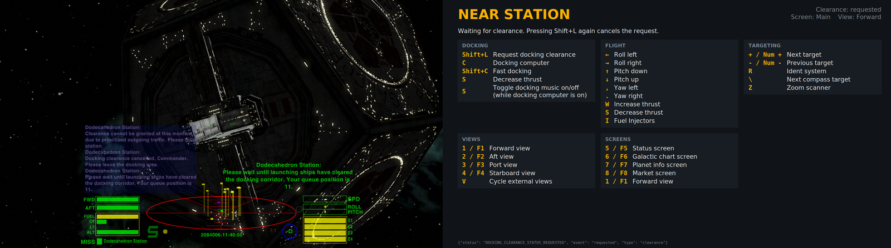
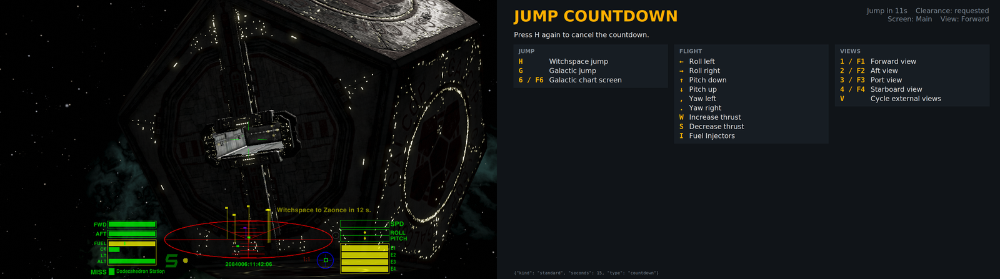
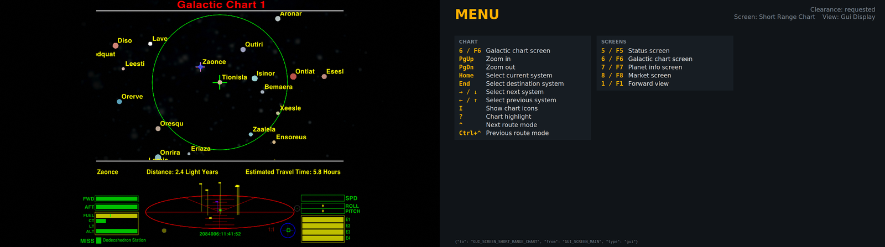
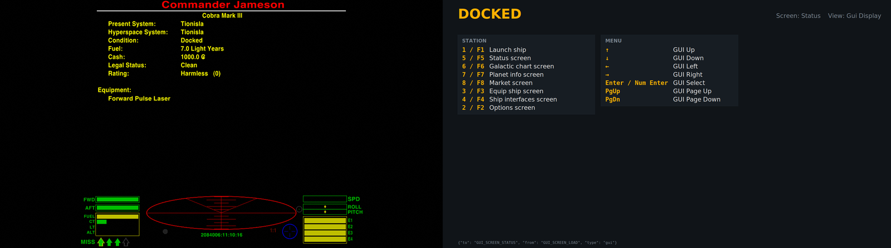
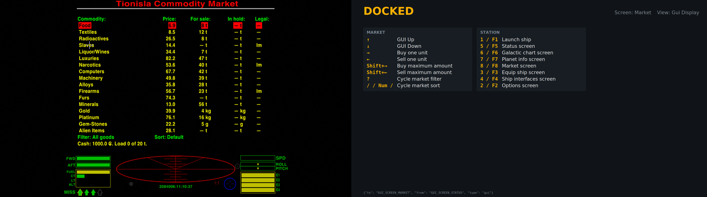

# Oolite Key Helper

A second-screen helper for the space game [Oolite](https://oolite.space/). It shows the keyboard shortcuts for whatever you're doing in the game at that moment, and updates as you play.

- **Docked**: station screens, and market, chart or planet-info keys on those screens
- **Flying**: flight, views, targeting, travel and screen keys
- **Near a station**: docking keys, your clearance status (none, requested, granted, timing out, not required) and docking tips
- **Red alert**: combat and escape keys
- **Jump countdown**: seconds left and how to cancel
- **Menu screens in flight**: the keys for that screen

The keys come from **your own game settings**: the game's built-in key config, your keyboard layout, and any keys you've changed in Oolite's Keyboard Configuration screen. If you remap something, the helper shows the new key.



*Above: waiting for docking clearance (the station has put you at queue position 11). The game is on the left and the helper's second screen is on the right.*

| | |
|---|---|
|  **Jump countdown**: time left, and how to cancel |  **Chart in flight**: chart keys and screen switching |
|  **Docked**: station screens and menu keys |  **Market**: buying and selling keys |

> Status: working and in daily use on Linux with Oolite 1.92.1. All screenshots are from real play.

## How it works

```
Oolite + CtxKeys.oxp ──JSON lines──▶ Latest.log ──follow──▶ helper window (Python/Tk)
  (game events)                                              (keys for the current context)
```

1. **[oxp/CtxKeys.oxp](oxp/CtxKeys.oxp)** is an Oolite add-on. Its world script listens for game events (docking, station aegis, alert level, docking clearance, jump countdowns, screen and view changes, and trade/chart events). It writes each event to the game log as a JSON line, e.g. `[ctxkeys]: {"type":"aegis","inside":true,...}`.
2. **[helper/](helper/)** follows `Latest.log`, works out the current context and draws the matching key list. The window has no title bar, sits on a second screen and never takes focus from the game.
3. On startup the helper reads the key bindings and the game's own key descriptions from the AppImage. It caches them until the AppImage changes, then applies your layout and key changes from the game's settings.

The add-on also reports trade and chart data: `market` includes the docked station's raw commodity-keyed market (price, quantity, quantity unit and numeric import/export legality), credits, available/total cargo space, fuel and cargo manifest; `bought` and `sold` include the commodity, units and per-unit price; `systems` lists systems within current fuel range with distance, economy, government, tech level and a `samplePrices` map keyed by commodity; `chart_target` contains the info-screen system and jump target. Market and sample prices, and the `price` in cargo events, use Oolite's decicredit scale (10 decicredits = 1 credit); cargo-event prices are per unit. Distances and fuel are in light-years. The source interfaces are [`station.market`](https://github.com/OoliteProject/oolite/blob/1.92.1/src/Core/Scripting/OOJSStation.m), [`SystemInfo.samplePrice()` and `distanceToSystem()`](https://github.com/OoliteProject/oolite/blob/1.92.1/src/Core/Scripting/OOJSSystemInfo.m), and the cargo events in [`PlayerEntity.m`](https://github.com/OoliteProject/oolite/blob/1.92.1/src/Core/Entities/PlayerEntity.m).

Example message lines:

```json
{"type":"market","station":"Lave Station","market":{"food":{"price":42,"quantity":8,"quantity_unit":0,"legality_export":0,"legality_import":0}},"credits":1200.5,"cargoSpace":{"available":18,"capacity":35},"fuel":7,"manifest":[{"name":"food","unit":"tonnes","quantity":2,"displayName":"Food"}]}
{"type":"bought","commodity":"food","units":2,"price":42}
{"type":"sold","commodity":"computers","units":1,"price":735}
{"type":"systems","fuel":7,"systems":[{"id":8,"name":"Zaonce","distance":6.5,"economy":8,"government":9,"techLevel":10,"samplePrices":{"food":48,"computers":738}}]}
{"type":"chart_target","infoSystem":8,"targetSystem":9}
```

A later version may receive the same messages over Oolite's debug console connection instead of the log. That would allow live data for a fuller HUD, as [oolite-mqtt-bridge](https://github.com/maikschulz/oolite-mqtt-bridge) does.

## Requirements

- Linux with X11 (developed on MATE)
- Oolite 1.92.1 Linux AppImage
- Python 3.11+ with Tkinter (`sudo apt install python3-tk` on Debian/Ubuntu)
- A second screen, or room for the window somewhere

## Setup

```bash
git clone https://github.com/stickleprojects/oolite-helper.git
cd oolite-helper

# 1. Python venv for the helper
python3 -m venv .venv
.venv/bin/pip install -e .

# 2. Install the add-on into the game's AddOns folder (a symlink, so updates are live)
mkdir -p ~/Games/Oolite/GameData/AddOns
ln -s "$PWD/oxp/CtxKeys.oxp" ~/Games/Oolite/GameData/AddOns/CtxKeys.oxp
```

The paths above assume the AppImage is at `~/Games/Oolite/oolite-1.92.1-x86_64.AppImage`. If yours is elsewhere, set these variables (both the launcher and the helper read them):

| Variable | Default |
|---|---|
| `OOLITE_APPIMAGE` | `~/Games/Oolite/oolite-1.92.1-x86_64.AppImage` |
| `OOLITE_GAMEDATA` | `GameData/` next to the AppImage |

## Running

Start the game with the launcher:

```bash
scripts/launch-oolite.sh
```

It starts the helper too, and the helper closes itself when the game exits. Point your desktop shortcut at this script. Set `OOLITE_NO_HELPER=1` to start only the game.

To run the helper on its own:

```bash
.venv/bin/oolite-helper [--stay] [window options]
```

`--stay` keeps the window open when the game exits. Right-click the window to close it.

### Demo mode (no Oolite needed)

The fake game writes one of the scripted timelines to a log file. In separate terminals, run:

```bash
python -m tests.fakegame scenarios/docking.yaml --log /tmp/fake.log --speed 2
.venv/bin/oolite-helper --log /tmp/fake.log --stay
```

The helper follows the scenario just as it follows Oolite's log; `--speed` changes the timeline speed. Try `jump`, `combat`, `menus`, `restart` or `quit` instead of `docking`. The scenario files are JSON-compatible YAML so the fake game needs no extra Python dependencies. The game does not need to be running, but the helper still reads key bindings and descriptions from the installed Oolite AppImage.

### Where the window goes

By default the helper fills the first monitor that **isn't** your primary one, e.g. a laptop screen next to the monitor you play on. To change that, copy [config.example.toml](config.example.toml) to `~/.config/oolite-helper/config.toml`:

```toml
[window]
screen = "DP-1"      # from `oolite-helper --list-screens`
width = "33%"        # pixels or % of that screen
height = "100%"
anchor = "right"     # top-left, top, top-right, left, center, right, bottom-left, bottom, bottom-right
margin = 0
font_scale = 0.9
```

That example gives a strip down the right-hand third of a big monitor. The number of key columns (one to three) follows the window width. In a single column, the last sections may run off the bottom of a short window; they're ordered most important first.

Each setting has a matching command-line option that overrides the file: `--screen`, `--width`, `--height`, `--anchor`, `--margin`, `--font-scale`. Use `--geometry WxH+X+Y` for exact placement.

```bash
.venv/bin/oolite-helper --list-screens
.venv/bin/oolite-helper --screen DP-1 --width 40% --anchor right
```

### Why the launcher?

On some systems, notably Ubuntu 26.04, whose default Rust coreutils link against `libsystemd`, the 1.92.1 AppImage's own start-up script fails: its bundled, older `libsystemd` breaks the host's `mkdir` and `mktemp`. Reported upstream as [OoliteProject/oolite#769](https://github.com/OoliteProject/oolite/issues/769). Oolite then logs to stdout (no `Latest.log`) and puts its settings in `~/GNUstep`. The launcher works around this. It runs the AppImage in "legacy" mode, sets Oolite's `OO_*` folder variables, and writes a GNUstep config, so everything (log, add-ons, saves, settings) lives in `GameData/` next to the AppImage.

## Project layout

| Path | What |
|---|---|
| `oxp/CtxKeys.oxp/` | The Oolite add-on (world script + manifest) |
| `helper/app.py` | The window |
| `helper/sources.py` | Follows `Latest.log`, including log rotation at game start |
| `helper/state.py` | Turns messages into game state and a context |
| `helper/contexts.py` | Which actions to show per context, and tips |
| `helper/keys.py`, `helper/plist.py` | Reads Oolite's key config and descriptions |
| `helper/screen.py`, `helper/config.py` | Window placement and the config file |
| `scripts/launch-oolite.sh` | Game launcher that fixes the data folders and starts the helper |

## Contributing

Issues and pull requests are welcome. `main` is protected, so every change, including the maintainer's, goes in through a pull request:

1. Fork the repo (or branch, if you have access) from an up-to-date `main`.
2. Make your change on a branch, e.g. `fix/separator`.
3. Open a pull request against `main` and describe what changed and how you tested it.

Automated checks on every PR are coming in [#6](https://github.com/stickleprojects/oolite-helper/issues/6).

## License

[MIT](LICENSE)

## Credits

- [Oolite](https://oolite.space/) and its contributors. Key descriptions shown in the helper come from the game's own files.
- [oolite-mqtt-bridge](https://github.com/maikschulz/oolite-mqtt-bridge), for the idea of getting game state out through an add-on.
