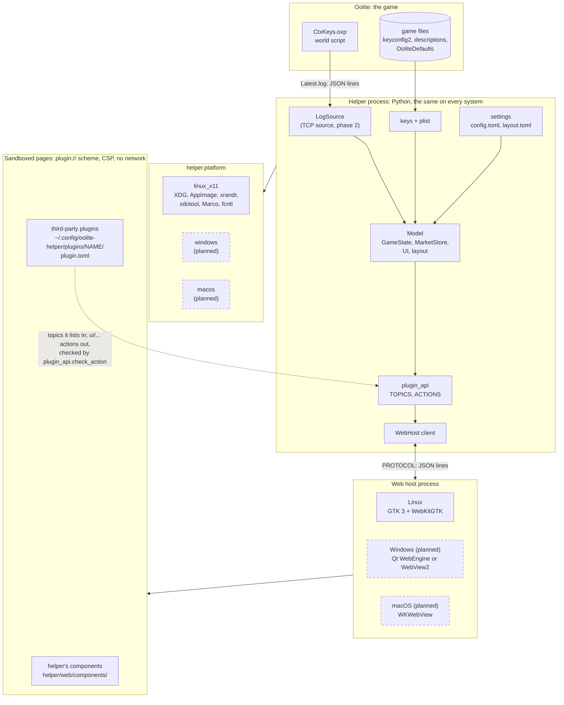

# How the helper is built

## Terms
- A **component** renders part of the model: `drive`, `clearance`, `trade_here`, the laptop window's heading, tabs and body, or a **plugin** (a component from outside the helper, run as a sandboxed web page).
- A **widget** hosts one or more components in a window of its own (`[[widgets]]` in `config.toml`). A widget can also be defined in a folder, `helper/web/widgets/<name>/` (`widget.toml`, optionally its own drawing, and a generated README), and then used by name with `widget = "<name>"`, changing any setting.
- A **widgetwindow** is a window with its own title that holds one or more widgets, stacked top to bottom (`[[widgetwindows]]` in `config.toml`, #124): component ⊂ widget ⊂ widgetwindow. `widgets.window_rect` places it and `widgets.stacked` places its widgets; in the web host it's one popup (a "frame") with a title bar over their views. In code it's `WindowSpec`, kept apart from OS windows (`WebWindow`, the game window).
- A **dock** is a place: beside the game window (`game:top`, `game:bottom`, `game:left`, `game:right`) where a widget or widgetwindow sits.
- The **layout** places every widget, either in a dock or free on a monitor (`helper/layout.py`, saved in `layout.toml`).
- A **panel** is only a box inside a component, such as a key panel, or the planned admin panel. It never means a widget.
- A **web view** is WebKit's browser view, which shows web widgets in the web host.

## The big picture
Dashed boxes are planned (a port). GitHub draws this from the Mermaid text below.



- **Third-party plugins** are folders the player adds under `~/.config/oolite-helper/plugins/` (see [plugins.md](plugins.md)). The helper discovers them at startup (`plugins.discover`), and the web host runs each one like the helper's own components: a sandboxed page that gets only the `plugin_api` topics its `plugin.toml` lists, and may send only the `ui/...` actions it lists, each checked before it reaches the model. They never see the model, the game or the file system directly, so they work unchanged on any system with a web host.
- **What a port replaces:** a module in `helper.platform` and a web host that speaks `PROTOCOL`. Everything else in the helper process, the add-on and every page stays the same.

Data flows one way, Redux-style (#53):

```
Oolite + CtxKeys.oxp ──messages──▶ LogSource ──▶ Model.dispatch ──▶ GameState / MarketStore
                                                       ▲                    │
                          clicks: "ui/..." actions ────┘                    ▼
                                                                Model.notify (each 200 ms)
                                                                            │
                                         selectors (named topics) ◀─────────┘
                                                    │ value changed?
                                                    ▼
                                              component.render(state)
```

| Redux / React | Here |
|---|---|
| Action | A message from the add-on (`{"type": "mass_lock", "by": "planet"}`), or a UI action (`{"type": "ui/open_commodity", "commodity": "furs"}`) |
| Reducer | `GameState.apply`, `MarketStore.apply`, `reduce_ui` |
| Store | `Model` ([helper/model.py](../helper/model.py)) |
| Selector | A pure function `model -> value`; named ones are `TOPICS` |
| Component | A web component ([helper/web/components/](../helper/web/components/)): `render(state)` from the topics it lists in `component.toml` |

## The model
- `model.dispatch(action)` applies one action. The window dispatches each batch of game messages, then calls `model.notify()` once. It also calls `notify()` on every 200 ms tick, so clock-driven values (countdowns, blinking) move on their own.
- `model.watch(selector, callback)` calls `callback(value)` now and then whenever `selector(model)` returns something different (compared with `==`). `model.subscribe("topic", callback)` does the same for a named topic. Both return a handle with `cancel()`.
- **Named topics** (`TOPICS` in `model.py`) are shared and memoised. Each one is computed once per notify pass however many components use it, and kept between passes until the state changes. Topics that depend on the clock give a period (`every`), e.g. 60 s for price ages shown in minutes.
- **Reducers replace values; they never edit them in place.** Otherwise `==` can't see the change.
- **Errors are isolated.** A selector or draw that raises is reported in the status line (once per distinct error) and retried on the next pass, and the other components carry on.
- **UI state:** selections that several components (or #50's widgets) might share live in the model's `UI` slice and change only through `ui/...` actions: the tab (a component name: the tabs widget, `widget = "tabs"`, shows it, its tab row being the widget's own frame), the open commodity, the chosen destination and quantity. A component's purely local choices (the trade table's sort order, the All keys group) stay in the component, which calls `self.refresh()` after changing one.

## Writing a component
Components are web components (#82): a folder in [helper/web/components/](../helper/web/components/) with a `component.toml` and its files, much like a Vue or React single-file component without a build step.

```toml
# helper/web/components/jump_status/component.toml
description = "Whether you can jump, and where you are"
topics = ["drive", "location"]       # what it reads: names from plugin_api.TOPICS
actions = []                         # what it may send: names from plugin_api.ACTIONS
needs = []                           # other components whose files it uses
```
```js
// helper/web/components/jump_status/jump_status.js
"use strict";

Oolite.component("jump_status", {
  render(state, refresh) {
    if (!state.drive) return null; // nothing to show: the widget may hide
    const { el } = OoliteDom;
    return el("div", "jump-status", state.location.system, OoliteFormat.chipText("JUMP", state.drive.jump));
  },
});
```
Each widget's page is generated from just the components it lists (and what they `need`), plus the shared files in [helper/web/lib/](../helper/web/lib/): `dom.js` (`el`, `button`), `format.js` (prices, sorting), `widget.js` (the loader) and `base.css`. The widget is sent only those components' topics and may send only their actions.

Rules:
- **Render from `state`, return a node or `null`.** `render` runs whenever a topic the widget reads changes. Keep purely local choices (a sort order) in the component's file, and call `refresh()` after changing one.
- **Read through topics.** If you need a new fact, add a topic to `plugin_api.TOPICS` (with a test and its docs), so other components and plugins can share it.
- **Never change state in a component.** Send a `ui/...` action with `oolite.dispatch`, listed in `actions`; add it to `reduce_ui` and `plugin_api.ACTIONS` if it's new.
- **Never take keyboard focus from the game**: clicks only, no text fields (verified on #20 and #59).
- **Keys and descriptions come from the game's files**, through topics such as `key_sections`, never typed into a component.
- **Size with the theme**: `calc(20pt * var(--oo-scale))` and the `--oo-...` colours, so it follows the large and compact layouts.

Give it **named states** beside it, `<name>.states.json` (`{"expiring": {"clearance": {...}}}`, only its own topics): the situations worth seeing. The same states feed three things:
- the **component harness** (`python -m helper.harness jump_status`, see CONTRIBUTING.md): pick a state or a scenario snapshot, edit any topic as JSON, and watch it react;
- its **tests** beside it (`<name>.test.js`, `node --test`, the fake DOM in `lib/testing.js`): `render("jump_status", states("jump_status").blocked)`, one state or one action per test;
- **pictures** of each state (`--shots`, or `tests/test_component_images.py` with `OOLITE_HELPER_SHOTS` set), and its generated **README.md** (`python -m helper.harness --readmes`, refreshed by CI on pull requests): what `component.toml` says, with a picture of each state.

The Tk fallback (`helper/tk/components/`, a `Component` with `select(model)` and `draw(value)`) has versions of `drive`, `clearance` and `trade_here` only; new components are web components.

## Plugins: web views in a separate process (#59)
Plugin visualisations are HTML and JavaScript pages, run in WebKit's sandbox by a separate **web host** process ([helper/webhost/host.py](../helper/webhost/host.py)), because Tk and GTK don't share a main loop. The helper drives it with JSON lines over a pipe; the protocol is in [helper/webhost/\_\_init\_\_.py](../helper/webhost/__init__.py).

```
helper (Tk)                                  web host (GTK, system Python)
  Model ──topics──▶ WebHost.publish ──pipe──▶ window per plugin ──▶ WebKit web process
  layout ─────────▶ WebHost.sync    ──pipe──▶ open / place / close    (bubblewrap sandbox)
  status ◀───────── WebHost.poll    ◀──pipe── loaded / page / error / crashed
```

- **The page's whole API is the `oolite` object**: `oolite.on(topic, fn)`, `oolite.dispatch(action)`, `oolite.resize(w, h)`, `oolite.log(text)`. It gets only the topics it listed, and may send only the `ui/...` actions it listed: the web host passes a dispatch through untouched, and the helper checks it against the manifest and each field (`plugin_api.check_action`) before it reaches the model. Writing a plugin: [plugins.md](plugins.md).
- **Lockdown:** the `plugin://<name>/` scheme serves only that plugin's folder, with a strict CSP (no network, no `eval`, no inline scripts); other navigation, pop-ups, downloads and developer tools are refused. Each window has its own ephemeral web context.
- **The host's environment closes the holes the #59 spike found** (`sandbox_env`): its own cache folder, an *untrusted* X cookie (no XTEST, RECORD, XInput or GLX), and no sound server. If the untrusted cookie can't be made, plugins don't start: it never falls back to the trusted one. `tests/test_webhost_live.py` checks the web process's mounts; run it after WebKit upgrades.
- **Failures stay contained:** a page that fails or crashes is closed and reported (`failed`), the others carry on, and a host that dies is restarted with backoff and its windows replayed.
- **Discovery and topics** ([helper/plugins.py](../helper/plugins.py)): at startup the helper reads each `~/.config/oolite-helper/plugins/<name>/plugin.toml` (name, version, `api`, topics, default size). A plugin is used like a component, alone in a widget: `components = ["jump-lamp"]`, placed by the same `place()` as other widgets. It gets only the topics it lists, from `plugin_api.TOPICS` ([helper/plugin_api.py](../helper/plugin_api.py)): **a public API of plain JSON shapes**, mapped from the model's topics, so the model's internals can change without breaking plugins. Add topics freely; changing a shape needs a new `api` version. The topics are enough to rebuild the whole laptop window as a plugin. They're memoised like the model's own (`model.memo`), and the helper's stylesheet is served to each page as `_oolite/theme.css`. Key bindings come two ways, both resolved from the game's files and the player's remaps through `model.keys()`/`model.describe()` (the same text as the Keys tab): the `key_sections` topic (what the Keys tab shows now) and `keys = [...]` in `plugin.toml` for specific actions (the `keys` topic).
- **Constants for logic, text for showing.** Everything meant for the player to read (`text`, `keys`, `description`) comes with constants beside it (`kind`, `status`, `action`, `bindings` in the game's own key names), so plugins never parse display text and keep working if it's in another language. Oolite has language add-ons that replace `descriptions.plist`; the helper reads only the AppImage's copy for now, and its own words are English. A broken plugin or a page that fails shows in the status line; the rest carry on.
- **Developing a plugin:** `.venv/bin/python -m helper.webhost <plugin folder> --at X,Y` opens it on its own, with a ticking `clock` topic.

## Layouts and the admin panel (planned)
A player-facing admin panel should eventually let the player swap layouts, add widgets and reopen closed ones, by clicking. It isn't built yet, but the pieces are shaped for it:

- **Windows are declarative.** `WebHost.sync({id: WebWindow})` takes the full set of windows that should exist, and opens, moves and closes to match. A layout change is just a new set; nothing calls "open" or "close" imperatively.
- **Widget ids are stable** (an `id` from `config.toml`, or `widget<n>:<first component>`), so a closed widget can be reopened where it was, and failures are kept per id (`WebHost.retry(id)` is the "reopen" button).
- **The layout is in the model** (`helper/layout.py`): a `layout` slice (the widgets, each with a stable id, its components, where it docks and whether it's open) changed only by `layout/...` actions: `layout/move_widget`, `layout/resize_widget`, `layout/close_widget` and `layout/open_widget` (later perhaps `layout/switch`). `WebWidgets` turns `model.topic("layout")` plus `game_window` into the `sync()` call. `config.toml` stays the player's hand-written defaults; changes made in the helper are saved to `layout.toml` beside it, never by rewriting `config.toml`.
- **The admin panel is part of the helper, never a plugin.** Plugins can only ask about themselves (`resize`, `show`). Discovered plugins and their status (loaded, failed, crashed) become a `plugins` topic the panel can list.
- **Web views are the main UI** (decided 2026-10-23, #50): new UI such as edit mode and the admin panel is built in the web host. The Tk window and Tk widgets stay only as the fallback for when WebKit isn't available.
- **It's opened by a click, not a key** (the game keeps keyboard focus): a small ⚙ tab docked beside the game window's top-left corner toggles #50's edit mode (move, resize, close) and will open the admin panel.

## Where things live
- `helper/state.py`: `GameState`, the reducer for game messages, plus derived properties (`context`, `details`, `where`).
- `helper/markets.py`: remembered markets and cost basis (persisted).
- `helper/browser.py`, `trade.py`, `contexts.py`: pure functions that the topics call (trade rows, advice, key sections, tips).
- `helper/model.py`: the store, topics and notification.
- `helper/web/`: the web components (`components/<name>/`), the shared page files (`lib/`), and discovery and page building (`__init__.py`) (#82).
- `helper/tk/components/`: the Tk fallback: `header.py` (heading, location, details, tip, status), `chips.py` (tabs, drive chips, clearance badge), `body.py` (key panels, All keys, trade table and detail, Trade here).
- `helper/app.py`: the window layout, polling the log and the command line.
- `helper/settings.py`: every setting (#135): `config.toml` and `layout.toml` read and checked through one pydantic model (`Settings`, `WindowSettings`, `Theme`, `WidgetSpec`, `WindowSpec`, named widgets), with the rules in it (sizes, docks, `height = "*"`, `"system"` colours, declared settings). `oolite-helper --check-config` lists every problem.
- `helper/widgets.py`: placing widgets and widgetwindows, docked to the game or a monitor (#50, #124), and the Tk fallback.
- `helper/platform/`: everything tied to the operating system and desktop (#140): the helper's folders, where the game's log, settings and key files are, the monitors, the game window, title bar colours and the single-instance lock. The rest of the helper imports only from `helper.platform`; `linux_x11/` is the one implementation so far. See Platforms below.
- `helper/layout.py`: the layout of the widgets (ids, `layout/...` actions) and saving `layout.toml`.
- `helper/plugins.py`: plugin discovery and `plugin.toml`, and `WebWidgets`: the web host windows for widgets, of the helper's components or a plugin (#59).
- `helper/plugin_api.py`: the public plugin API: topics, actions and the theme (#59).
- `examples/plugins/`: example plugins (`keys`: the Keys tab as a plugin).
- `helper/webhost/`: plugin web views (#59): the client (`__init__.py`), the host process (`host.py`) and a dev runner (`__main__.py`).

## Platforms
The helper runs on Linux with X11. What ties it there is in two places:

- **`helper/platform/`** (#140): the names listed in its `__init__.py`, implemented for Linux in `linux_x11/` (XDG folders, the AppImage, `xrandr`, `xdotool`/`xprop`, Marco themes, `fcntl`). A port adds one module beside it with the same names; `helper.platform` says which names are missing when it's imported on a system it doesn't know.
- **The web host** (`helper/webhost/host.py`): GTK and WebKitGTK, in its own process behind `PROTOCOL`, so another system can bring its own host.

#139 lists what a Windows version could use for each (libraries, file locations, and a trap: `LogSource` keeps `Latest.log` open, which on Windows can stop Oolite renaming it).
