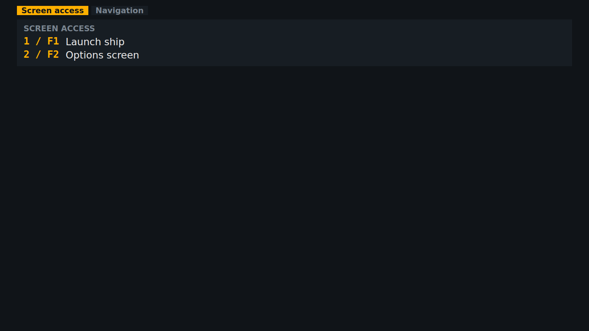

<!-- Made by `python -m helper.harness --readmes` from component.toml and all_keys.states.json: edit those and run it again. -->

# all_keys

Every key the game has, by group: click a group to show it

| | |
|---|---|
| **Reads** | `all_keys` |
| **Sends** | nothing |
| **Needs** | [`keys`](../keys/README.md) |
| **Files** | `all_keys.css`, `all_keys.js` |
| **Tests** | `all_keys.test.js` |

Use it in a widget: `components = ["all_keys"]`. Try it: `python -m helper.harness all_keys`.

## Named states

From `all_keys.states.json`. *Shows nothing* means it draws nothing in that state; a widget hides while all its components do.

<table>
<tr><td valign="top"><b>before the keys are known</b> <i>shows nothing</i></td><td valign="top"><b>two groups</b> </td></tr>
</table>
