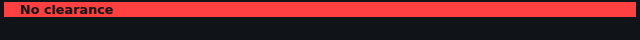
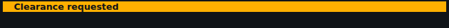
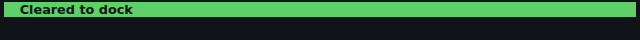
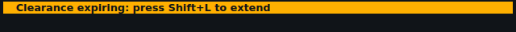
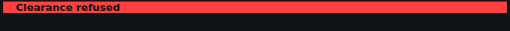

<!-- Made by `python -m helper.harness --readmes` from component.toml and clearance.states.json: edit those and run it again. -->

# clearance

Docking clearance near a station; flashes while it's timing out

| | |
|---|---|
| **Reads** | `clearance` |
| **Sends** | nothing |
| **Needs** | nothing |
| **Files** | `clearance.css`, `clearance.js` |
| **Tests** | `clearance.test.js` |

Use it in a widget: `components = ["clearance"]`. Try it: `python -m helper.harness clearance`.

## Named states

From `clearance.states.json`. *Shows nothing* means it draws nothing in that state; a widget hides while all its components do.

<table>
<tr><td valign="top"><b>away from stations</b> <i>shows nothing</i></td></tr>
<tr><td valign="top"><b>none</b> </td></tr>
<tr><td valign="top"><b>requested</b> </td></tr>
<tr><td valign="top"><b>granted</b> </td></tr>
<tr><td valign="top"><b>expiring</b> </td></tr>
<tr><td valign="top"><b>refused</b> </td></tr>
</table>
