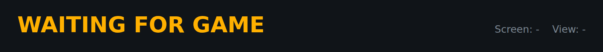
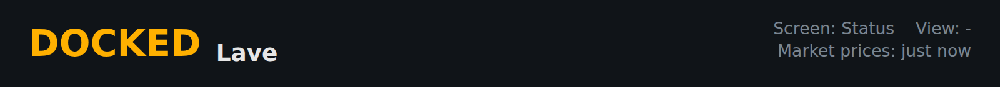
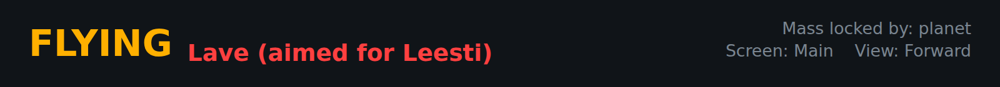
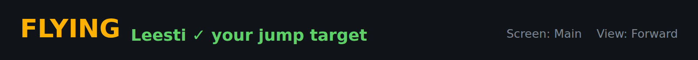
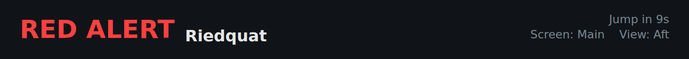

<!-- Made by `python -m helper.harness --readmes` from component.toml and heading.states.json: edit those and run it again. -->

# heading

What you're doing (the context), where you are, and the details: countdowns, screen and view, price age

| | |
|---|---|
| **Reads** | `context`, `location`, `details`, `screen`, `market_age` |
| **Sends** | nothing |
| **Needs** | nothing |
| **Files** | `heading.css`, `heading.js` |
| **Tests** | `heading.test.js` |

Use it in a widget: `components = ["heading"]`. Try it: `python -m helper.harness heading`.

## Named states

From `heading.states.json`. *Shows nothing* means it draws nothing in that state; a widget hides while all its components do.

<table>
<tr><td valign="top"><b>waiting for game</b> </td><td valign="top"><b>docked</b> </td></tr>
<tr><td valign="top"><b>flying, aimed for a target</b> </td><td valign="top"><b>arrived at the target</b> </td></tr>
<tr><td valign="top"><b>red alert</b> </td></tr>
</table>
