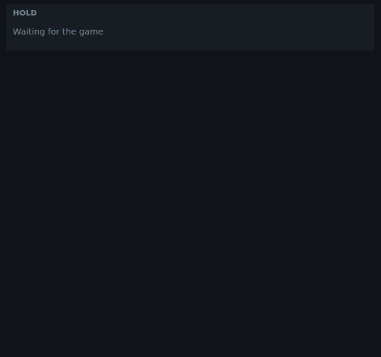
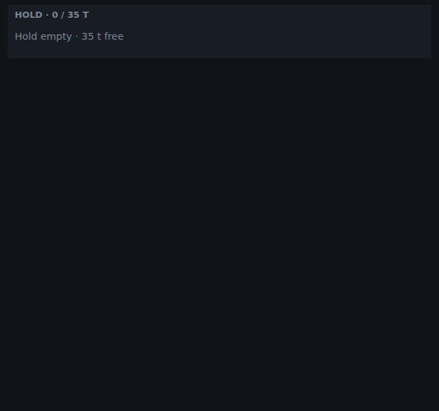
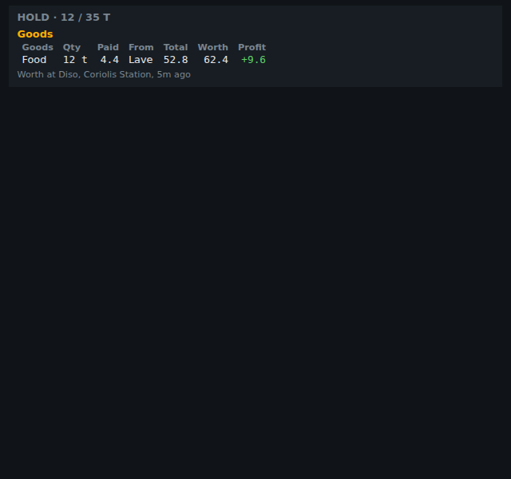
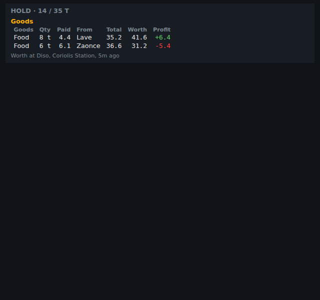
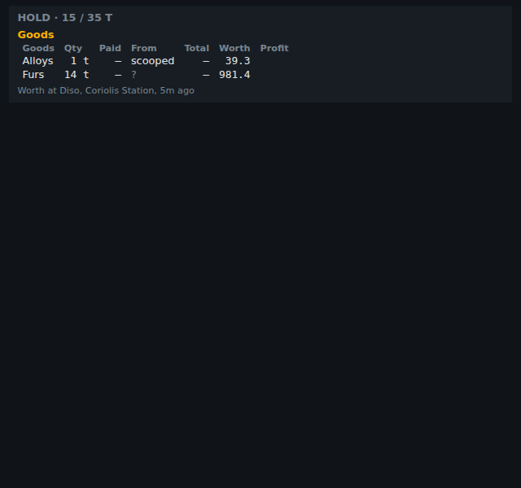
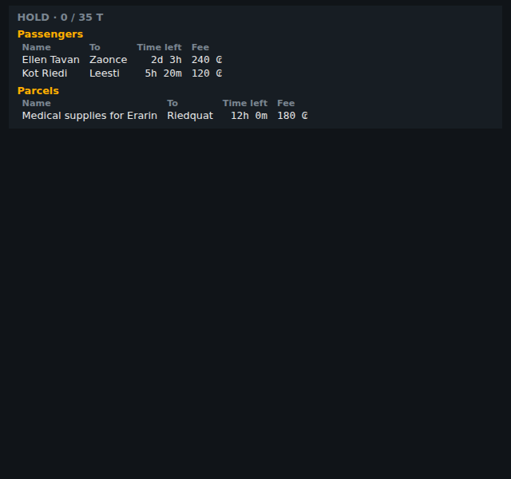
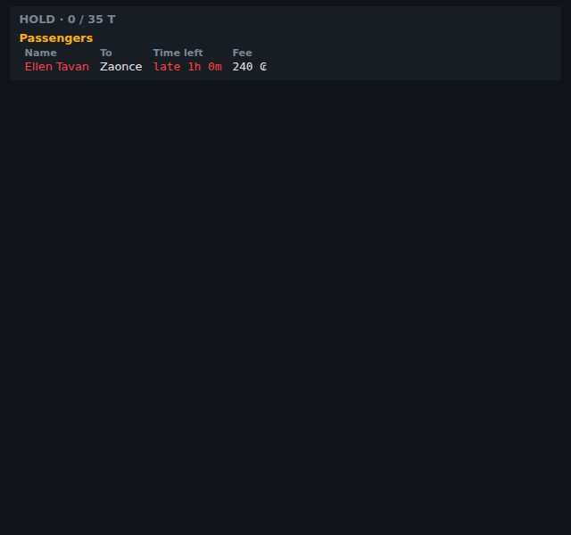
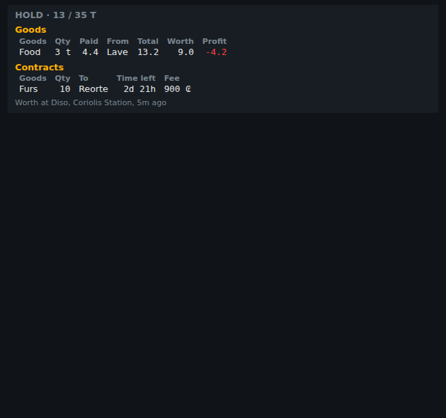

<!-- Made by `python -m helper.harness --readmes` from component.toml and hold.states.json: edit those and run it again. -->

# hold

Everything aboard: each lot of goods with where it was bought, what you paid and what it's worth at the last market; passengers, parcels and contracts with their time left (red when late); says when the hold is empty

| | |
|---|---|
| **Reads** | `hold` |
| **Sends** | nothing |
| **Needs** | nothing |
| **Files** | `hold.css`, `hold.js` |
| **Tests** | `hold.test.js` |

Use it in a widget: `components = ["hold"]`. Try it: `python -m helper.harness hold`.

## Named states

From `hold.states.json`. *Shows nothing* means it draws nothing in that state; a widget hides while all its components do.

| State | Picture |
|---|---|
| **waiting for the game** |  |
| **empty** |  |
| **one lot** |  |
| **two lots of food** |  |
| **scooped** |  |
| **passengers and parcels** |  |
| **late passenger** |  |
| **contract** |  |
