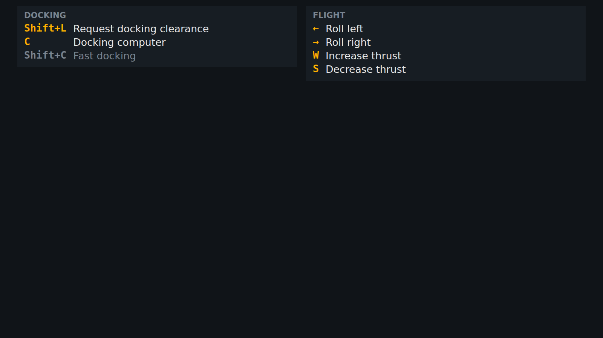
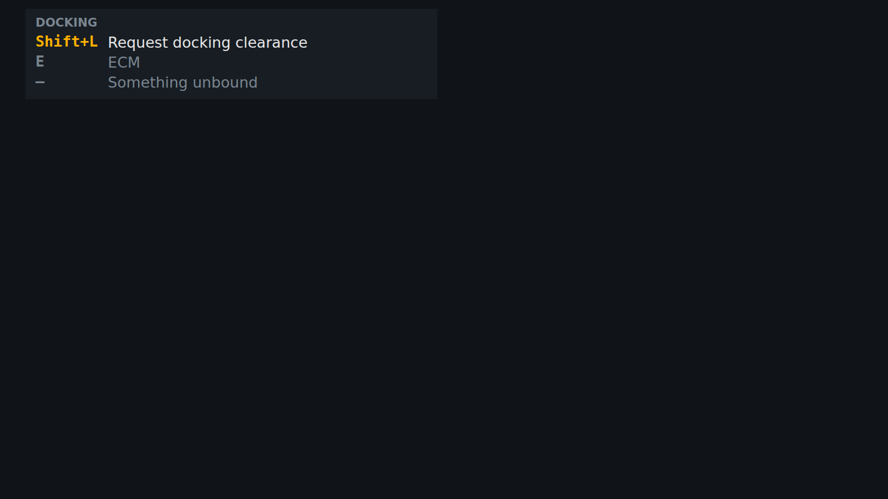

<!-- Made by `python -m helper.harness --readmes` from component.toml and keys.states.json: edit those and run it again. -->

# keys

The keys for what you're doing now, in panels

| | |
|---|---|
| **Reads** | `key_sections` |
| **Sends** | nothing |
| **Needs** | nothing |
| **Files** | `keys.css`, `keys.js` |
| **Tests** | `keys.test.js` |

Use it in a widget: `components = ["keys"]`. Try it: `python -m helper.harness keys`.

## Named states

From `keys.states.json`. *Shows nothing* means it draws nothing in that state; a widget hides while all its components do.

<table>
<tr><td valign="top"><b>no keys</b> <i>shows nothing</i></td><td valign="top"><b>near a station</b> </td></tr>
<tr><td valign="top"><b>missing and unbound</b> </td></tr>
</table>
