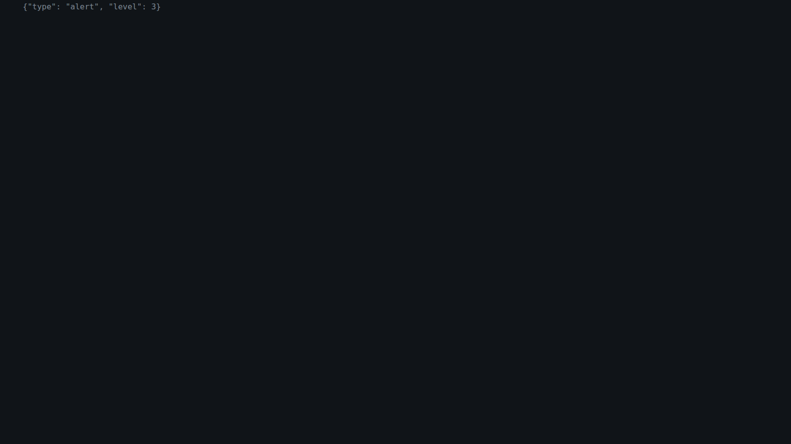
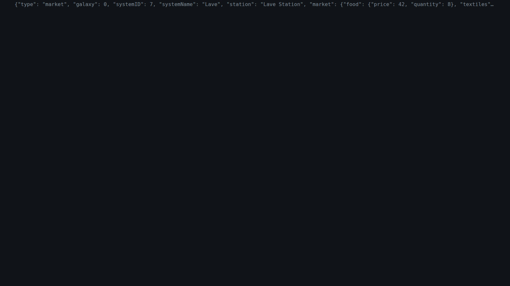

<!-- Made by `python -m helper.harness --readmes` from component.toml and last_message.states.json: edit those and run it again. -->

# last_message

The last message from the game, as raw JSON, for debugging

| | |
|---|---|
| **Reads** | `last_message` |
| **Sends** | nothing |
| **Needs** | nothing |
| **Files** | `last_message.css`, `last_message.js` |
| **Tests** | `last_message.test.js` |

Use it in a widget: `components = ["last_message"]`. Try it: `python -m helper.harness last_message`.

## Named states

From `last_message.states.json`. *Shows nothing* means it draws nothing in that state; a widget hides while all its components do.

<table>
<tr><td valign="top"><b>before any</b> <i>shows nothing</i></td><td valign="top"><b>short</b> </td></tr>
<tr><td valign="top"><b>a whole market</b> </td></tr>
</table>
