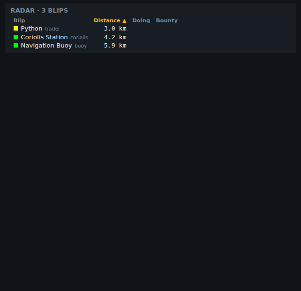
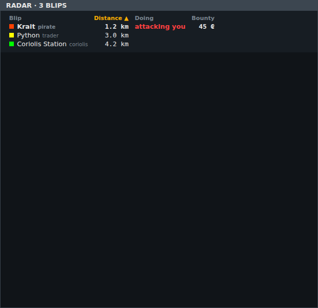
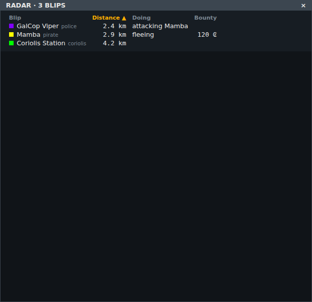
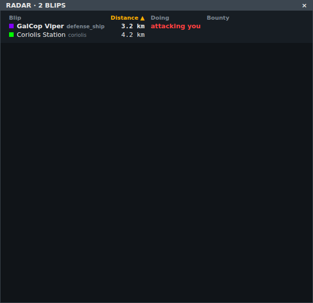
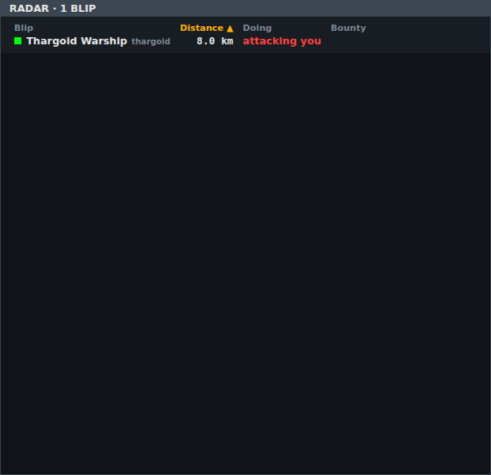
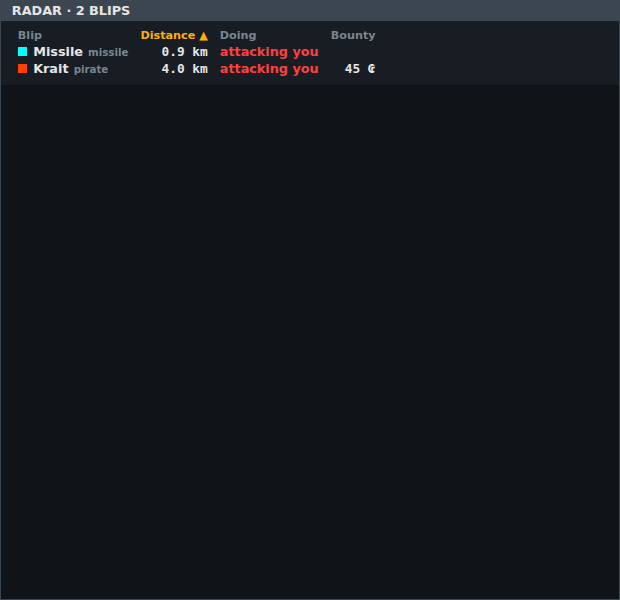
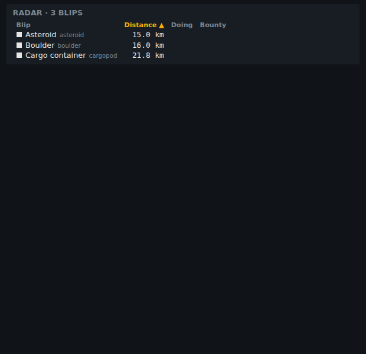
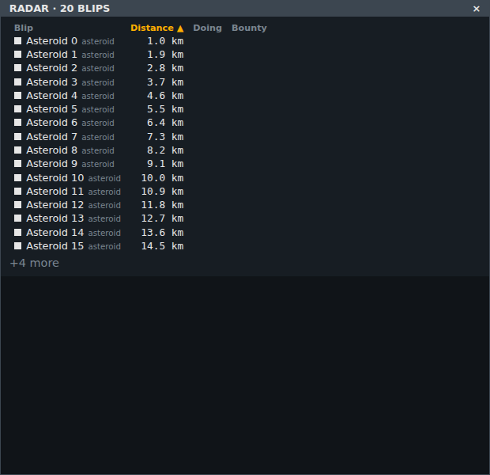

<!-- Made by `python -m helper.harness --readmes` from component.toml and radar.states.json: edit those and run it again. -->

# radar

Every blip on the scanner, nearest first: its scanner colour (flashing as the scanner does), name and role, distance, what it's doing and its bounty; click a heading to sort

| | |
|---|---|
| **Reads** | `radar` |
| **Sends** | nothing |
| **Needs** | nothing |
| **Files** | `radar.css`, `radar.js` |
| **Tests** | `radar.test.js` |

Use it in a widget: `components = ["radar"]`. Try it: `python -m helper.harness radar`.

## Named states

From `radar.states.json`. *Shows nothing* means it draws nothing in that state; a widget hides while all its components do.

| State | Picture |
|---|---|
| **nothing on the scanner** | *shows nothing* |
| **quiet** |  |
| **pirate attacking you** |  |
| **police chasing an offender** |  |
| **police attacking you** |  |
| **thargoid** |  |
| **missile incoming** |  |
| **cargo and rocks** |  |
| **many blips** |  |
