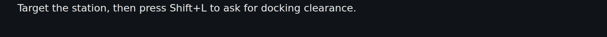
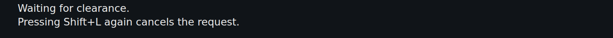

<!-- Made by `python -m helper.harness --readmes` from component.toml and tip.states.json: edit those and run it again. -->

# tip

A tip for what you're doing right now, e.g. how to get docking clearance

| | |
|---|---|
| **Reads** | `tip` |
| **Sends** | nothing |
| **Needs** | nothing |
| **Files** | `tip.css`, `tip.js` |
| **Tests** | `tip.test.js` |

Use it in a widget: `components = ["tip"]`. Try it: `python -m helper.harness tip`.

## Named states

From `tip.states.json`. *Shows nothing* means it draws nothing in that state; a widget hides while all its components do.

<table>
<tr><td valign="top"><b>no tip</b> <i>shows nothing</i></td></tr>
<tr><td valign="top"><b>one line</b> </td></tr>
<tr><td valign="top"><b>two lines</b> </td></tr>
</table>
