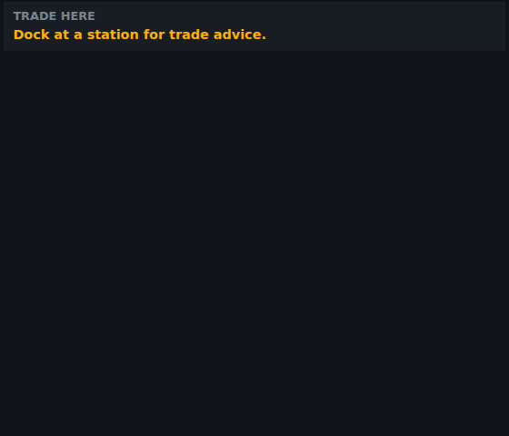
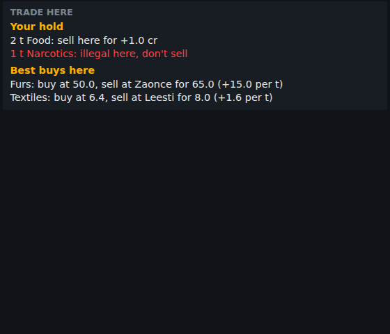

<!-- Made by `python -m helper.harness --readmes` from component.toml and trade_here.states.json: edit those and run it again. -->

# trade_here

Your hold, prices against the last market, and the best buys; a hint until you dock

| | |
|---|---|
| **Reads** | `market_advice` |
| **Sends** | nothing |
| **Needs** | nothing |
| **Files** | `trade_here.css`, `trade_here.js` |
| **Tests** | `trade_here.test.js` |

Use it in a widget: `components = ["trade_here"]`. Try it: `python -m helper.harness trade_here`.

## Named states

From `trade_here.states.json`. *Shows nothing* means it draws nothing in that state; a widget hides while all its components do.

<table>
<tr><td valign="top"><b>not docked yet</b> </td><td valign="top"><b>docked with cargo</b> </td></tr>
</table>
