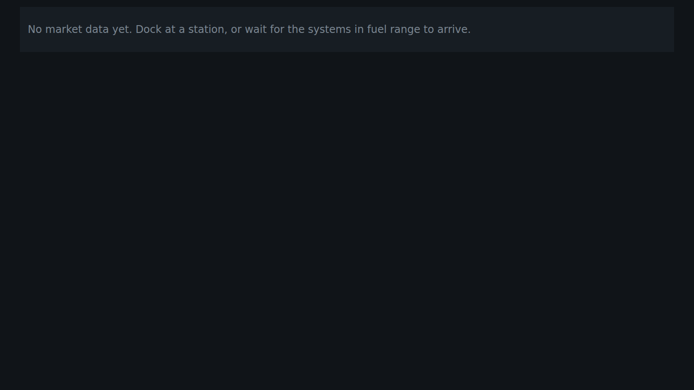
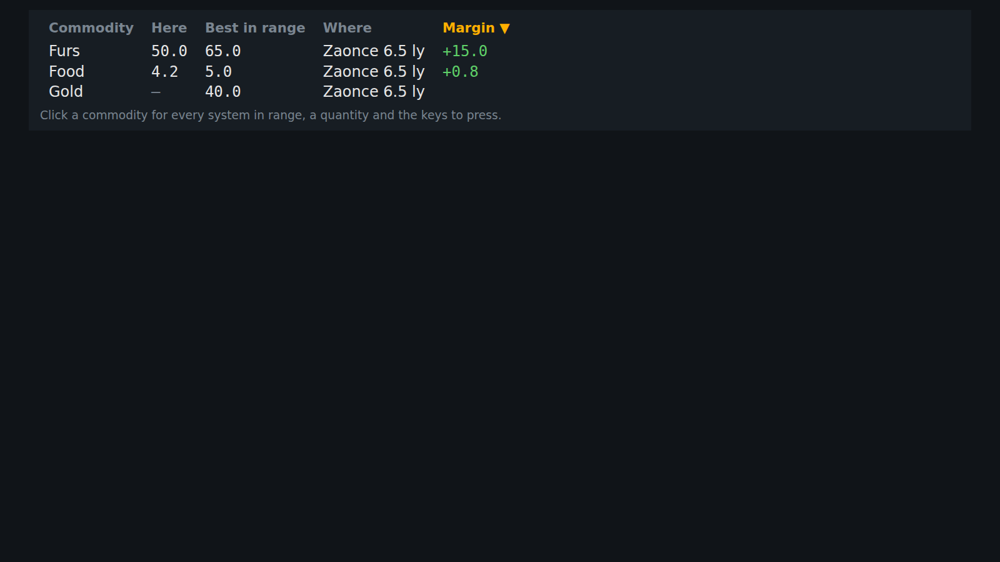
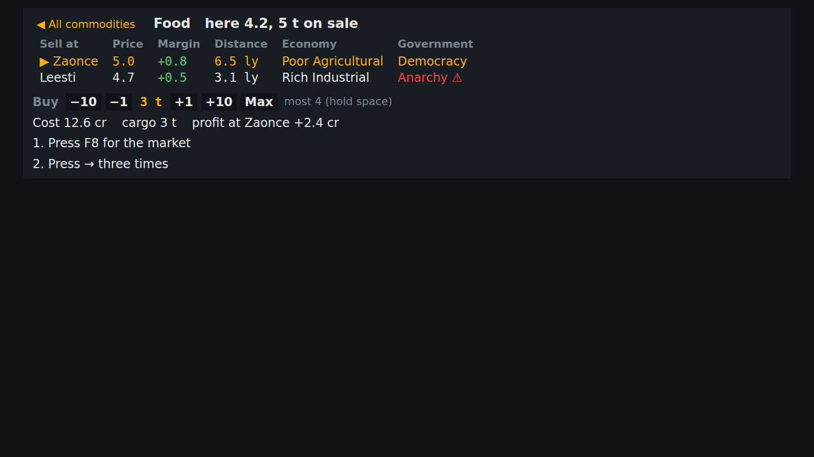

<!-- Made by `python -m helper.harness --readmes` from component.toml and trade_table.states.json: edit those and run it again. -->

# trade_table

Every commodity with prices here and in range, sortable; click one for where to sell, how many to buy and the keys

| | |
|---|---|
| **Reads** | `trade_rows`, `trade_detail`, `selection` |
| **Sends** | `ui/open_commodity`, `ui/choose_destination`, `ui/change_quantity` |
| **Needs** | nothing |
| **Files** | `trade_detail.js`, `trade_table.css`, `trade_table.js` |
| **Tests** | `trade_table.test.js` |

Use it in a widget: `components = ["trade_table"]`. Try it: `python -m helper.harness trade_table`.

## Named states

From `trade_table.states.json`. *Shows nothing* means it draws nothing in that state; a widget hides while all its components do.

<table>
<tr><td valign="top"><b>no market data</b> </td><td valign="top"><b>three commodities</b> </td></tr>
<tr><td valign="top"><b>food open</b> </td></tr>
</table>
