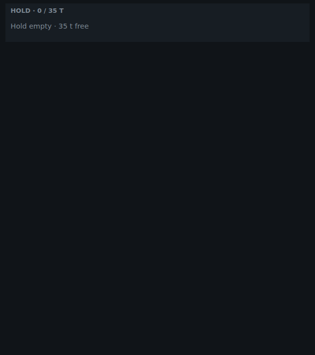
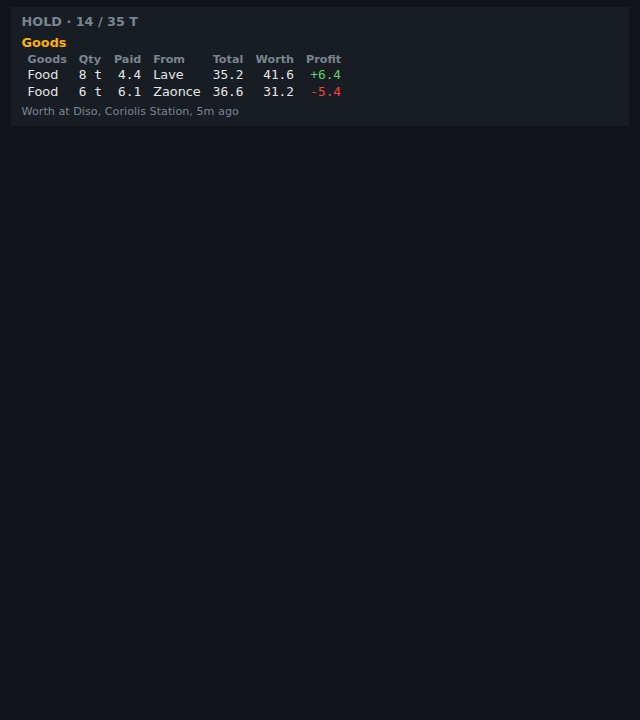
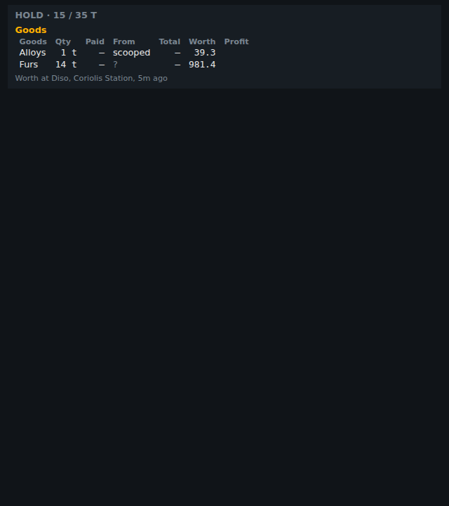
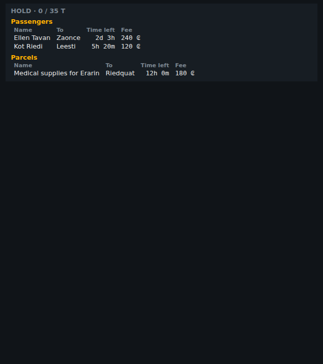
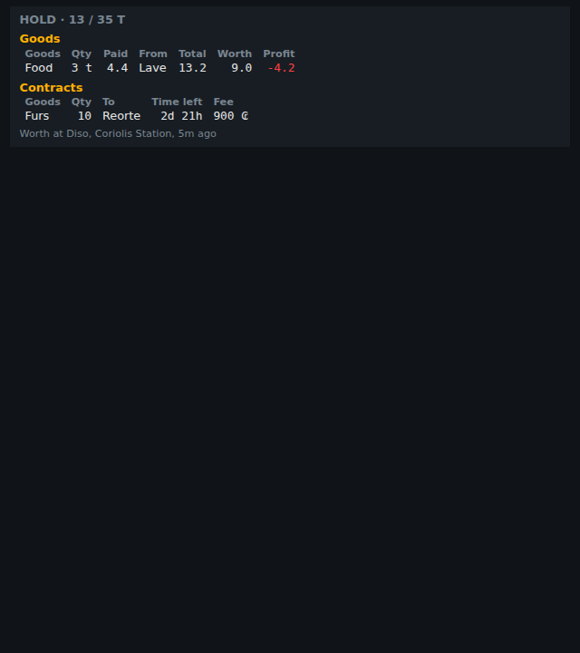

<!-- Made by `python -m helper.harness --readmes` from widget.toml: edit it and run it again. -->

# hold-beside

Everything aboard, right of the game window; stays open, saying when the hold is empty

| | |
|---|---|
| **Components** | [`hold`](../../components/hold/README.md) |
| **Dock** | `game:right` |
| **Width** | 640 px |
| **Height** | the game's height |
| **Layout** | `compact` |

Use it in `config.toml`, changing any setting `[[widgets]]` takes:

```toml
[[widgets]]
widget = "hold-beside"
```

Its id is `hold-beside` unless you give another. Try it: `python -m helper.harness hold-beside`.

## Named states

From `[states]` in `widget.toml`: each names a state of each of its components. *Shows nothing* means none of them draws anything then, so the widget hides.

| State | Picture |
|---|---|
| **empty** |  |
| **two lots of food** |  |
| **scooped** |  |
| **passengers and parcels** |  |
| **contract** |  |
