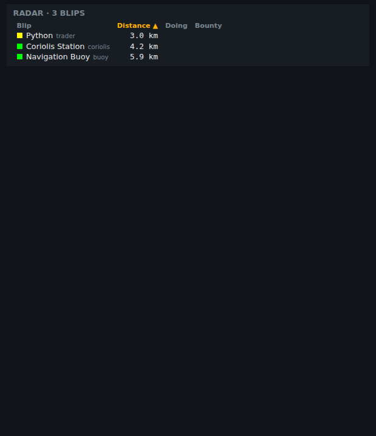
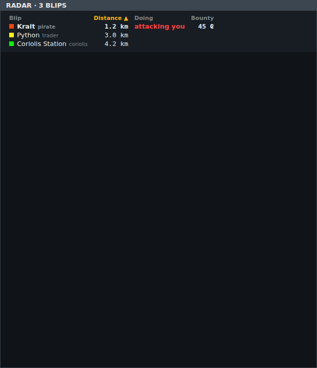
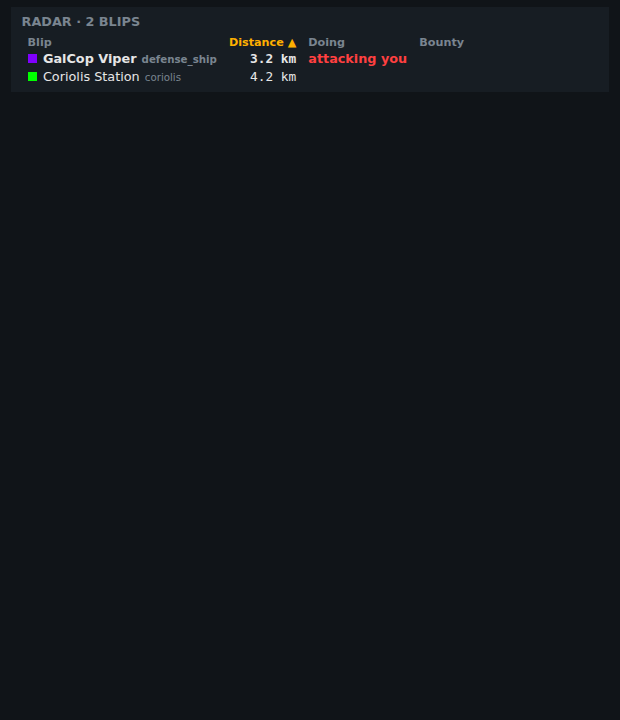
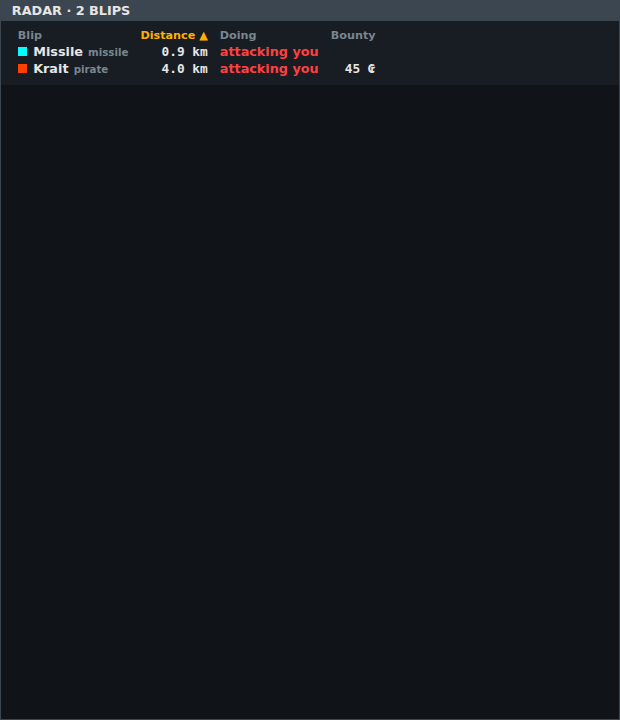
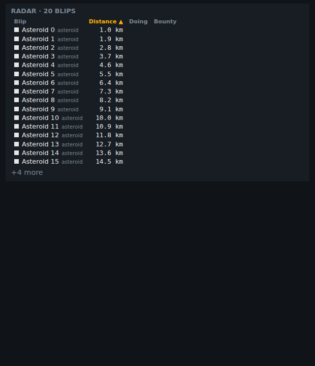

<!-- Made by `python -m helper.harness --readmes` from widget.toml: edit it and run it again. -->

# radar-beside

Every blip on the scanner, left of the game window while flying

| | |
|---|---|
| **Components** | [`radar`](../../components/radar/README.md) |
| **Dock** | `game:left` |
| **Width** | 620 px |
| **Height** | the game's height |
| **Layout** | `compact` |

Use it in `config.toml`, changing any setting `[[widgets]]` takes:

```toml
[[widgets]]
widget = "radar-beside"
```

Its id is `radar-beside` unless you give another. Try it: `python -m helper.harness radar-beside`.

## Named states

From `[states]` in `widget.toml`: each names a state of each of its components. *Shows nothing* means none of them draws anything then, so the widget hides.

| State | Picture |
|---|---|
| **quiet** |  |
| **pirate attacking you** |  |
| **police attacking you** |  |
| **missile incoming** |  |
| **many blips** |  |
