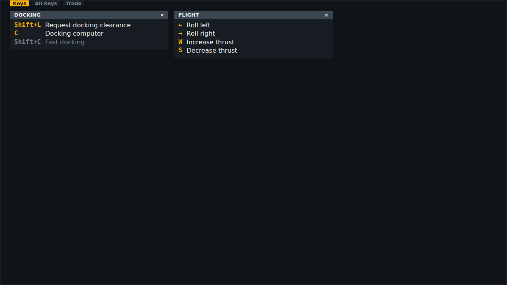
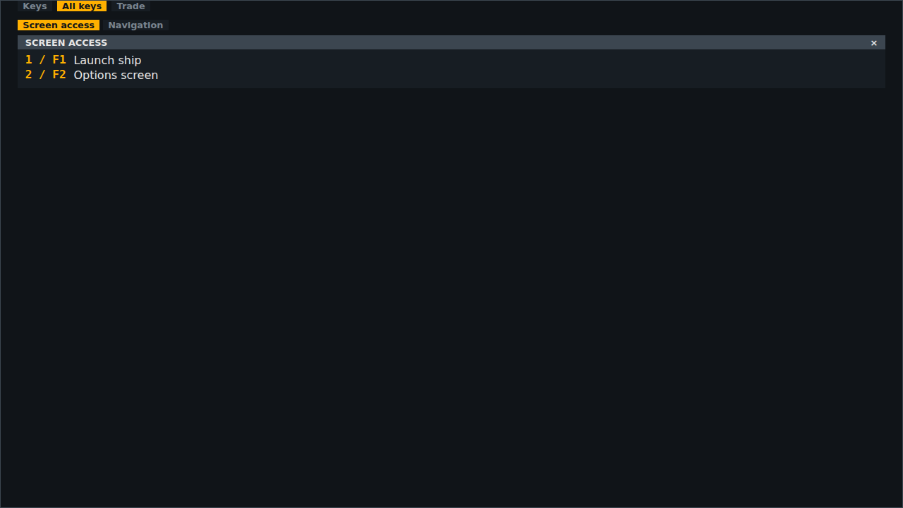
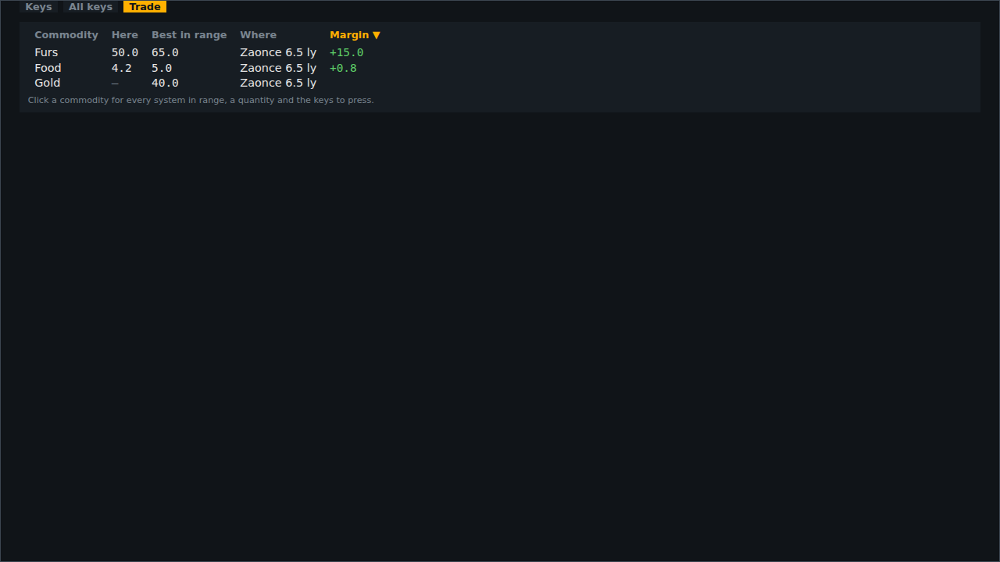

<!-- Made by `python -m helper.harness --readmes` from widget.toml: edit it and run it again. -->

# tabs

Keys, all keys and the trade table, one at a time under a tab row

| | |
|---|---|
| **Components** | [`keys`](../../components/keys/README.md), [`all_keys`](../../components/all_keys/README.md), [`trade_table`](../../components/trade_table/README.md) |
| **Dock** | free, on the desktop |
| **Width** | what its components need |
| **Height** | what its components need |
| **Layout** | `compact` |
| **Reads too** | `tabs` |
| **Sends too** | `ui/choose_tab` |

Use it in `config.toml`, changing any setting `[[widgets]]` takes:

```toml
[[widgets]]
widget = "tabs"
```

Its id is `tabs` unless you give another. Try it: `python -m helper.harness tabs`.

## Named states

From `[states]` in `widget.toml`: each names a state of each of its components. *Shows nothing* means none of them draws anything then, so the widget hides.

| State | Picture |
|---|---|
| **near a station** |  |
| **all keys** |  |
| **trading** |  |
