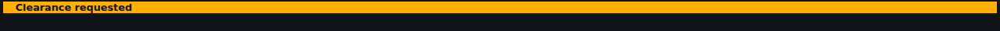
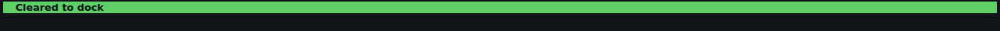
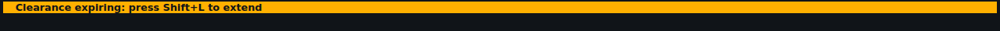
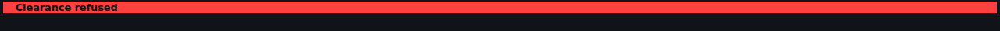
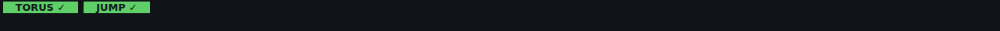
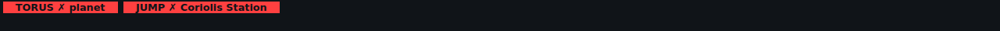
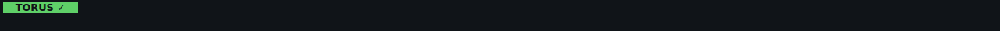

<!-- Made by `python -m helper.harness --readmes` from widget.toml and its components' states: edit those and run it again. -->

# top-strip

Docking clearance and the TORUS/JUMP lamps in a strip above the game window

| | |
|---|---|
| **Components** | [`clearance`](../../components/clearance/README.md), [`drive`](../../components/drive/README.md) |
| **Dock** | `game:top` |
| **Width** | the game's width |
| **Height** | what its components need |
| **Layout** | `compact` |

Use it in `config.toml`, changing any setting `[[widgets]]` takes:

```toml
[[widgets]]
widget = "top-strip"
```

Its id is `top-strip` unless you give another. Try it: `python -m helper.harness top-strip`.

## Named states

Its components' named states, from their `.states.json` files. *Shows nothing* means none of its components draws anything then, so the widget hides.

| State | Picture |
|---|---|
| **clearance: away from stations** | *shows nothing* |
| **clearance: none** |  |
| **clearance: requested** |  |
| **clearance: granted** |  |
| **clearance: expiring** |  |
| **clearance: refused** |  |
| **drive: docked** | *shows nothing* |
| **drive: both ready** |  |
| **drive: mass locked** |  |
| **drive: jump blocked** |  |
| **drive: torus only** |  |
