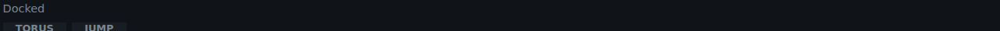
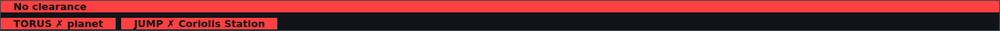
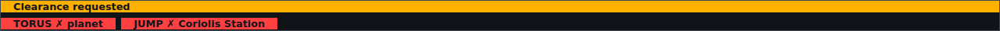
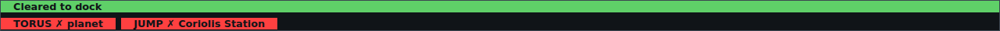
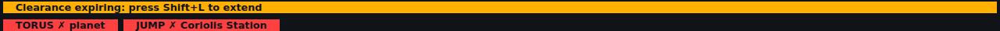
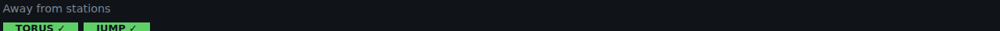
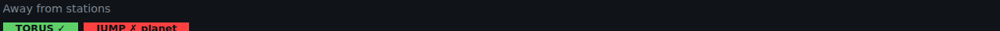

<!-- Made by `python -m helper.harness --readmes` from widget.toml: edit it and run it again. -->

# top-strip

Docking clearance and the TORUS/JUMP lamps in a strip above the game window

| | |
|---|---|
| **Components** | [`clearance`](../../components/clearance/README.md), [`drive`](../../components/drive/README.md) |
| **Dock** | `game:top` |
| **Width** | the game's width |
| **Height** | what its components need |
| **Layout** | `compact` |

Use it in `config.toml`, changing any setting `[[widgets]]` takes:

```toml
[[widgets]]
widget = "top-strip"
```

Its id is `top-strip` unless you give another. Try it: `python -m helper.harness top-strip`.

## Named states

From `[states]` in `widget.toml`: each names a state of each of its components. *Shows nothing* means none of them draws anything then, so the widget hides.

| State | Picture |
|---|---|
| **docked** |  |
| **just launched** |  |
| **waiting for clearance** |  |
| **cleared to dock** |  |
| **clearance running out** |  |
| **refused clearance** |  |
| **in open space** |  |
| **too near a planet to jump** |  |
