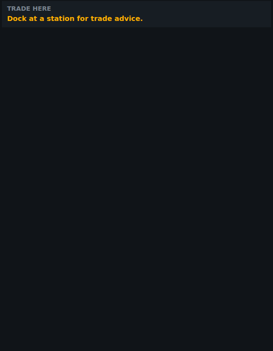
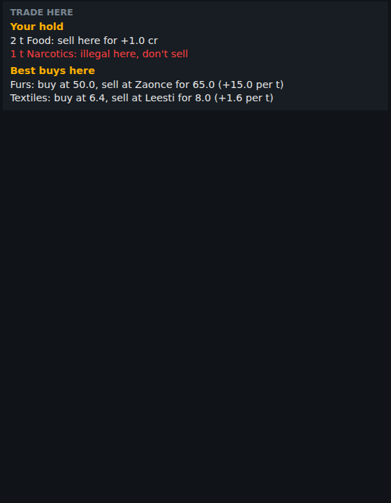

<!-- Made by `python -m helper.harness --readmes` from widget.toml and its components' states: edit those and run it again. -->

# trade-beside

What's in the hold, the last market and the best buys, beside the game window while docked

| | |
|---|---|
| **Components** | [`trade_here`](../../components/trade_here/README.md) |
| **Dock** | `game:right` |
| **Width** | 560 px |
| **Height** | the game's height |
| **Layout** | `compact` |

Use it in `config.toml`, changing any setting `[[widgets]]` takes:

```toml
[[widgets]]
widget = "trade-beside"
```

Its id is `trade-beside` unless you give another. Try it: `python -m helper.harness trade-beside`.

## Named states

Its components' named states, from their `.states.json` files. *Shows nothing* means none of its components draws anything then, so the widget hides.

| State | Picture |
|---|---|
| **trade_here: not docked yet** |  |
| **trade_here: docked with cargo** |  |
